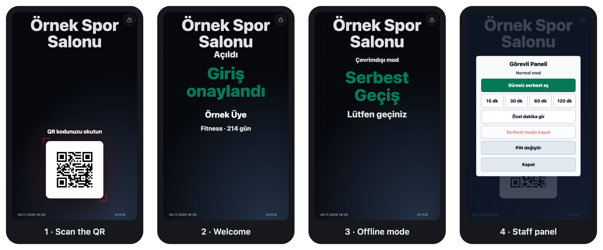
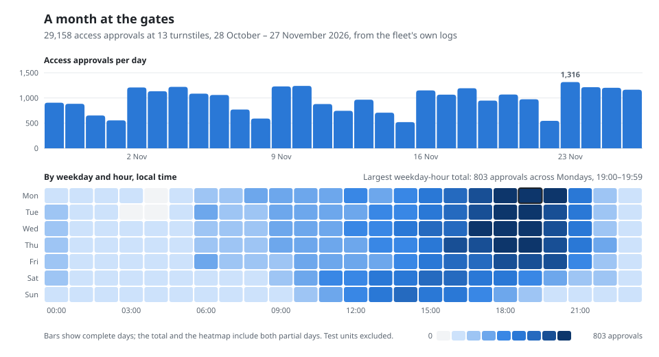
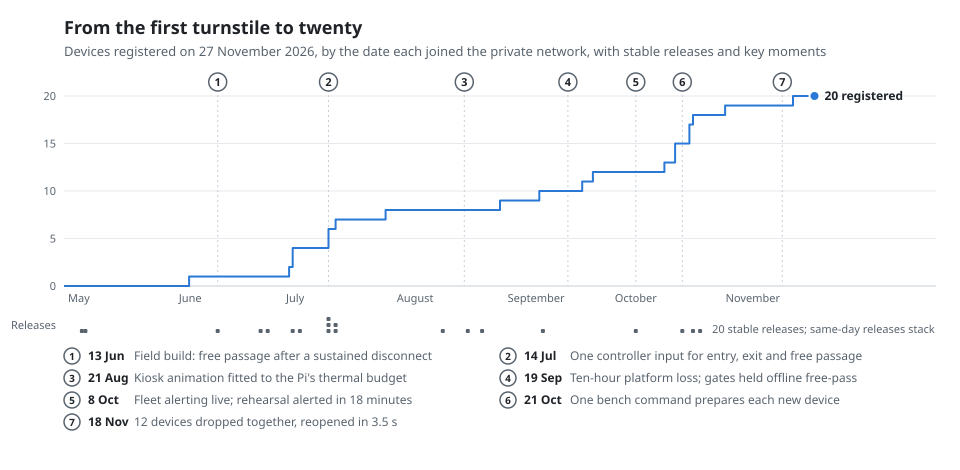
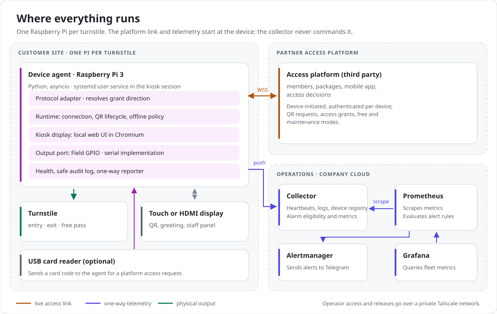
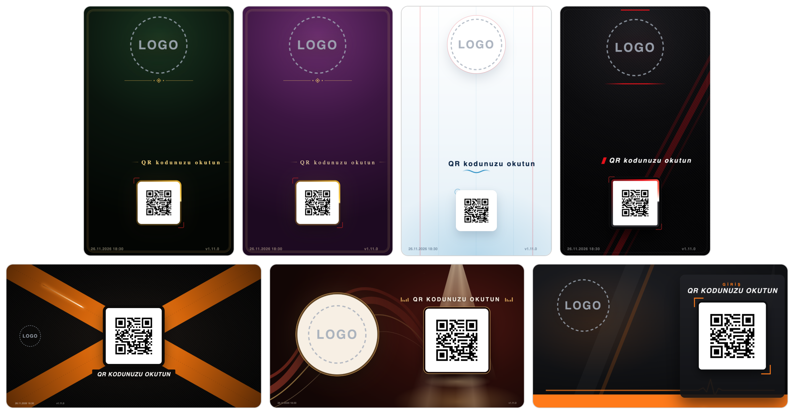

# Turnstile Device Agent

**QR access control for gyms, studios and a swimming facility: the Raspberry Pi software at each turnstile, its integration with a partner access platform, and the fleet operations behind it. I designed and built it, and have run it in production since June 2026, as the sole software engineer.**

In its first six months the fleet grew to more than 20 turnstiles in seven cities and handled more than 90,000 access approvals; in the 30 days to 27 November 2026 alone, 13 turnstiles handled 29,158, each new pulse a median of 3 ms after the device logged the approval. The partner platform decides who may enter; my software owns everything at the gate: the QR on the screen, the signal to the turnstile controller, what happens when the network or the platform disappears, and how the fleet is prepared, released, watched and supported. A company technician mounts the hardware; I bring each device into service and run it remotely.

*The kiosk on a 7-inch touch screen, rendered from the real interface with test data: the QR to scan, an entry approval, offline mode (the gate is free and the status line says why), and the staff panel behind the venue's own PIN.*

The production source is private company property. This repository holds the case study, its diagrams and aggregate charts: no production code, no customer or venue names, no partner data. Screens use test data.

## At a glance

| | |
|---|---|
| **Role** | Sole software engineer: architecture, device software, integration with the partner platform and the turnstile controllers, device preparation, releases, monitoring and support |
| **In the field** | In production since June 2026: more than 20 turnstiles at gyms, dance and pilates studios and a swimming facility in seven cities across Türkiye |
| **Runs on** | One Raspberry Pi 3 per turnstile with a 7-inch touch screen or an HDMI screen, and a cloud collector with Prometheus, Alertmanager and Grafana |
| **Integrates with** | The partner platform's WebSocket API; turnstile controllers through GPIO in the field (direct, a relay board or a single shared input), with RS-485 serial as another implementation; USB card readers |
| **Delivery** | 20 stable releases from May to October 2026, every update to a field device delivered remotely; since late June each arrives as an exact-tag bundle with a known-good rollback |
| **Stack** | Python (asyncio, WebSockets), Linux, systemd, Raspberry Pi GPIO and serial, Chromium kiosk, FastAPI, Prometheus, Grafana, Tailscale, pytest, GitHub Actions |

## Field results

<picture>
  <source media="(prefers-color-scheme: dark)" srcset="assets/month-at-the-gates-dark.svg">
  
</picture>

From 28 October to 27 November 2026, 17 devices reported heartbeats and 13 received access approvals (test units excluded):

| | |
|---|---|
| **Access approvals** | 29,158 for entry or exit; about 2,300 different members in November alone (from distinct name hashes); more than 90,000 in the first six months, June to November 2026 |
| **Speed on the device** | For the 28,834 new pulses, a median of 3 ms from the device logging the approval to the pulse start (99th percentile 20 ms), and 12 ms to the GPIO output-start log |
| **Every approval decided** | 29,158 approvals, 29,158 output decisions: 28,834 new pulses, 205 extensions of a pulse already open, 119 opposing requests ignored; zero pulse-failure events |
| **Self-healing** | Every dropped platform connection reconnected on its own while the agent kept running: 1,400 of 1,419, in a median of 4.1 seconds; the other 19 were followed by a service stop or restart first. On 18 November, 12 devices dropped together and the last reopened 3.5 seconds after the first close |
| **Offline** | 513 offline free-pass activations; the 490 that ended at a stable reconnection lasted a median of 33 seconds |
| **Overnight** | After 124 of 125 overnight gaps (many venues switch the power off at night), the device came back and handled an access approval that day |

[How these were measured →](docs/operations.md#field-results-method)

## Six months in the field

<picture>
  <source media="(prefers-color-scheme: dark)" srcset="assets/fleet-growth-dark.svg">
  
</picture>

**1 · Free passage when the platform is gone (June).** Only online member approvals depend on the partner platform, reached over venue networks I cannot see. A turnstile that locks members out whenever the internet drops is worse than no turnstile, so the field build already held the gate in free passage after a sustained disconnect and returned to the QR only on a stable connection. The cost, that offline entries are not individually authorised, is recorded in the logs.

**2 · One controller input for entry, exit and free passage (July).** One venue's controller takes entry, exit and free mode on a single shared input, while the driver and my bench test tool had both assumed a separate exit line. I changed the driver and the tool together and closed the work once all three roles fired on the live device: a test tool that shares the product's assumption cannot catch its bug.

**3 · Fitting the kiosk animation to the Pi's thermal budget (August).** After a temperature warning, I measured the full animation cycle on one Pi 3 B+ instead of trusting a spot reading, ruled out element count and background, and found the cost in the animation timing. With stepped timing Chromium used 0.15–0.35 CPU cores instead of 0.9–1.7, and only the smooth run crossed the soft-temperature limit in a ten-minute comparison.

**4 · Ten hours without the platform (September).** When the platform's address changed overnight, eight turnstiles at four venues lost it for ten hours; every one held offline free-pass and kept retrying. I traced the failure to name resolution and changed the fleet's DNS resolver: all eight reconnected within a minute, with no deploy, restart or site visit.

**5 · Making a working fallback visible (October).** At another venue, a network intercepting encrypted traffic held two gates in offline free-pass for most of a day, and to staff the screen looked like deliberate free mode. I kept the member-facing message, added a staff label that tells an outage from deliberate free passage, made offline free-pass visible to fleet monitoring, and made device alerts start only within each venue's opening hours. On 8 October a controlled reporting interruption raised a Telegram alert within 18 minutes.

**6 · One bench command per device (October).** As the fleet passed a dozen devices, I combined the existing provisioning and verification steps into one resumable bench command: exact-tag release, settings, private remote access, telemetry and a pending registry entry, with the platform credential checked before registration and a software-readiness verdict or the failed checks at the end. The technician mounts the unit and checks passage in both directions on site. On 21 October, ten devices had individual software-ready reports.

**7 · A month of decisions at the gate (November).** On 18 November, 12 devices lost the platform together and the last reopened its connection 3.5 seconds after the first close. A second approval can also arrive while a pulse is still open; queuing it could fire a pulse after it stopped being relevant, so a same-direction approval can extend the open pulse and an opposing one is logged and ignored. In the 30-day audit that happened 205 and 119 times among 29,158 approvals, each with an output decision. When drops line up across cities, the collector shows it: on 23 October ten devices at six venues lost their connections within 80 seconds, and I prepared a dated report with the timestamps for the partner to investigate.

More of what the field built into the system, from rejected credentials to staff free mode: [running the fleet →](docs/operations.md#what-months-in-the-field-built-into-the-system)

## Architecture

<picture>
  <source media="(prefers-color-scheme: dark)" srcset="assets/architecture-dark.svg">
  
</picture>

- **The platform authorizes; the device owns the gate.** The partner platform authorizes individual member access; the agent owns the connection, the screen, the gate output and the field behaviour, including the offline policy and staff free mode.
- **Raw messages stop at one adapter.** It turns platform messages into typed events and resolves a grant's direction before the runtime can request a pulse; the output drivers never see the protocol.
- **Links start at the device.** Fleet telemetry uses outbound connections and needs no inbound monitoring port at the venue, the collector can never command a device, and operators reach field devices over a private Tailscale network.

What a member's scan looks like step by step, and what the turnstile does when the platform link drops: [full architecture →](docs/architecture.md)

## Key decisions

| Chosen | Why | Rejected |
|---|---|---|
| Offline free-pass after a grace period, labelled for staff as "offline mode" | A turnstile that locks members out whenever the internet drops is worse than no turnstile | Denying entry while the platform is unreachable |
| A connection counts as authenticated only after the platform's first message | The platform accepts the handshake and rejects a wrong credential afterwards; before the first successful exchange, a rejection sends the device to technician setup instead of free passage | Trusting the completed handshake |
| One output interface: fake, GPIO relay, single shared input, RS-485 serial | New turnstile hardware is a new implementation, not a change to the runtime | Hardware logic inside the protocol code |
| Exact-tag Git bundles, hash-pinned dependencies in a candidate environment, known-good rollback | A field device's version is never ambiguous and holds no repository credential | Pulling a branch on the device; updating packages in place |
| Devices only push heartbeats and logs; device alerts start only within each venue's opening hours | Telemetry without monitoring software on the devices, and no device alert just because a venue is closed | Monitoring agents on the Pis; alerting on every missing heartbeat |
| Logs of metadata only: events, short one-way hashes, lengths, identifiers | Support and fleet analysis without storing names, QR text or card codes in clear | Raw payloads in logs |

Costs and the rest of the decisions: [design decisions →](docs/decisions.md)

## One release, a design for every venue

*Seven venue designs from the fleet, rendered from the real interface with a demo QR and placeholder branding. A device-local stylesheet changes the look without modifying the shared release.*

## How I work

I own the architecture, the decisions and the releases, and I work directly with the partner platform's team and the company's field technician. I use fake outputs for live protocol tests and verify hardware-dependent changes on a Pi before they reach a venue. I use Claude Code and Codex daily as coding agents under repository rules, review each change and own the release decision.

## Read more

- [Architecture](docs/architecture.md): parts, one access end to end, trust boundaries, the runtime on the device.
- [Design decisions](docs/decisions.md): what was chosen, why, what it costs, and what was rejected.
- [Running the fleet](docs/operations.md): device preparation, releases, monitoring, what months in the field built into the system, and how the field results were measured.

Other production work: [Kadans](https://github.com/berkaybakac/kadans-case-study), in-store audio and AI announcements for a regional grocery chain, and [Tellal](https://github.com/berkaybakac/tellal-case-study), the AI announcement platform behind it.
