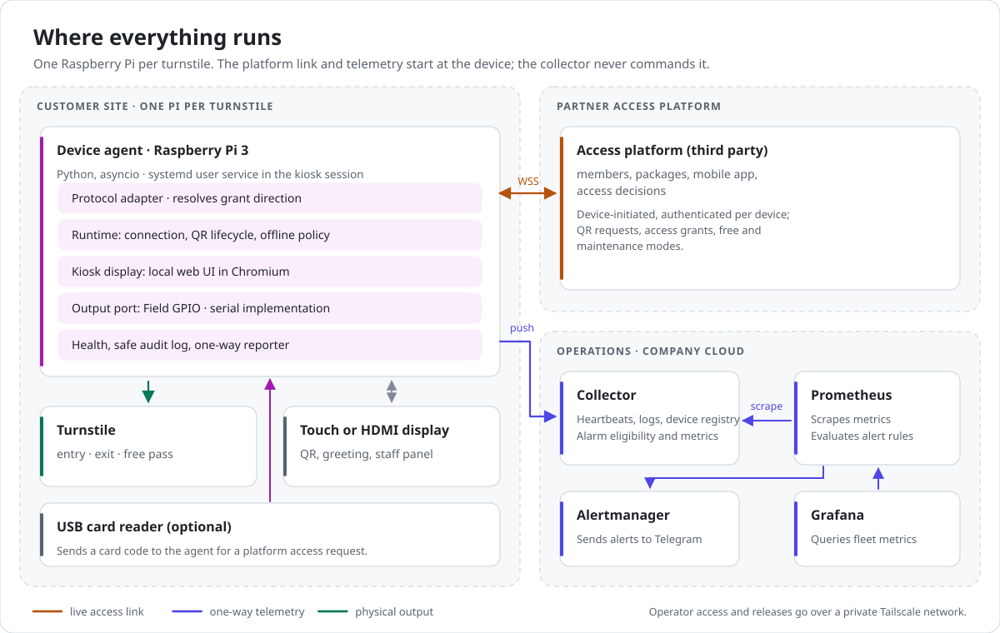
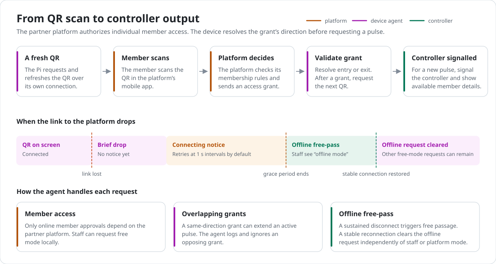

# Architecture

[← Back to the overview](../README.md)

<picture>
  <source media="(prefers-color-scheme: dark)" srcset="../assets/architecture-dark.svg">
  
</picture>

## Parts and responsibilities

| Part | Responsibility |
|---|---|
| Protocol adapter | Parses platform messages and resolves entry or exit from a grant before the runtime can request a pulse |
| Device runtime | One authenticated WebSocket per device: QR requests and refresh, access grants, platform free and maintenance modes, keepalive, reconnect and the offline policy |
| Kiosk display | Chromium runs the local UI on a touch or HDMI display. The React kiosk streams state changes, polls during reconnection and clears stale member details after a grace period. The classic and portrait layouts poll for state. |
| Output port | Fake (smoke tests), GPIO relay board, single shared-pin GPIO, or serial for RS-485 controllers; one interface, chosen per device |
| Card reader (optional) | Validates a USB card code and sends it to the platform as an access request; never drives the output |
| Staff panel (touch screens) | Timed or open-ended free mode behind the venue's own PIN |
| Health and audit | A health command for the field, a structured audit log of metadata only, and a heartbeat for the collector |
| Reporter | Pushes minute heartbeats and audit records to the collector and retries unacknowledged batches |
| Collector and monitoring | The collector keeps the registry and recent record digests, determines alarm eligibility and exposes metrics. Prometheus scrapes the metrics and evaluates rules. Alertmanager delivers alerts to Telegram. Grafana shows the fleet. |
| Operator tooling | Resumable bench setup and software handoff, followed by on-site physical checks. Operators deploy exact tags and check device health over a private Tailscale network. |

## From QR scan to controller output

<picture>
  <source media="(prefers-color-scheme: dark)" srcset="../assets/scan-to-gate-dark.svg">
  
</picture>

1. The device requests a QR over its authenticated connection, displays it and refreshes it before it expires.
2. The member scans the QR in the platform’s mobile app. The partner platform checks membership and authorizes individual access.
3. The agent resolves entry or exit from the grant. After a grant it requests the next QR.
4. For a new pulse the agent signals the controller off the event loop and shows the available member details supplied by the platform. A grant in the same direction can extend an active pulse. The agent logs and ignores an opposing grant.
5. The audit log records the event, its connection and sequence, and the pulse outcome, without the member's name or the QR text.

## Trust boundaries

- **Partner platform → device.** The platform authorizes individual member access. When an expected device identity is configured, state-changing events wait for a match. The agent applies the offline policy and handles staff free mode locally.
- **Device → turnstile:** only the output port drives hardware; its electrical settings are validated against the device's hardware profile before the service may start.
- **Device → collector.** Fleet telemetry uses outbound connections and requires no inbound monitoring port at the venue. The collector receives telemetry and has no device command channel.
- **Operator → device.** Operators use SSH over a private Tailscale network. Routine deployment has two bounded passwordless root helpers.
- **Credentials.** Field devices carry no repository credentials. Runtime credentials are provisioned separately from the release bundle.

## Runtime on the device

The agent is a Python asyncio application running as a systemd user service in the kiosk's desktop session, from a locked virtual environment. Blocking hardware work runs off the event loop. Timers run the reporter and a metrics sampler. Display orientation and touch alignment heal themselves at boot while QR, connection and output keep running.

## Stack

Python (asyncio, WebSockets), Chromium kiosk with HTML, CSS and JavaScript (React for one display profile), Raspberry Pi GPIO and serial, Linux and systemd, Bash, Tailscale, FastAPI (collector), Prometheus, Alertmanager, Grafana, Docker Compose (monitoring stack), pytest, Ruff, Pyright, ShellCheck, Playwright, GitHub Actions.
