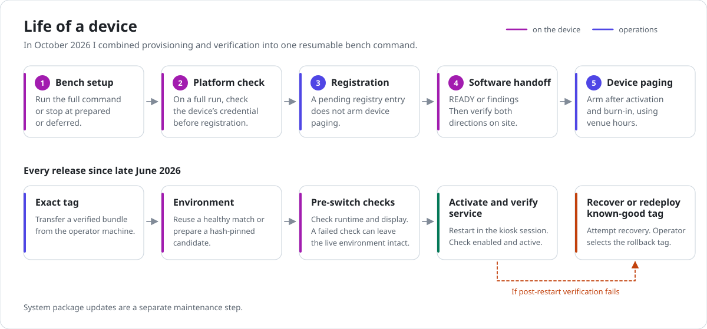
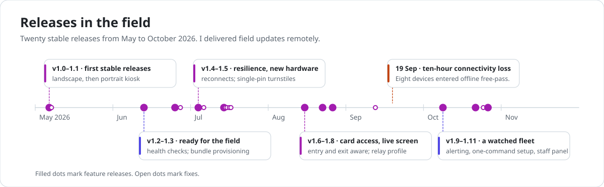

# Running the fleet

[← Back to the overview](../README.md)

I prepare and support the device software, deploy releases and monitor the fleet. A company technician mounts each unit and checks physical passage on site.

<picture>
  <source media="(prefers-color-scheme: dark)" srcset="../assets/operations-dark.svg">
  
</picture>

## Commissioning a new turnstile

In October 2026 I combined existing provisioning and verification steps into one resumable bench command. A full run checks the partner credential before registration and reports software readiness or the failed checks. A card can also stop at prepared or deferred and resume when the site settings are available. A pending registry entry does not arm device paging.

On 21 October, ten devices had individual software-ready reports. A failed stage fails that device’s overall handoff. After software handoff, the technician mounts the unit and checks passage in both directions on site.

I assign a separate platform credential to each serving gate and stage a replacement without connecting it under the live credential.

## Releases

Since late June 2026 I have deployed exact-tag bundles over the private network. Deploy reuses a healthy matching environment or prepares a hash-pinned candidate. Runtime and display checks precede activation. A failed candidate check can leave the live environment untouched. After restart, deploy verifies that the service is enabled and active. If verification fails, deploy attempts recovery. The operator can redeploy a known-good tag.

<picture>
  <source media="(prefers-color-scheme: dark)" srcset="../assets/timeline-dark.svg">
  
</picture>

## Monitoring and alerting

Each device sends a heartbeat every minute and pushes audit events. The collector owns the device registry, determines alarm eligibility and exposes fleet metrics. Prometheus scrapes those metrics and evaluates the rules. Alertmanager sends notifications to Telegram. Grafana displays the fleet.

| Alert | Fires when |
|---|---|
| Device offline | An armed device’s last heartbeat is over 25 minutes old for a further 2 minutes |
| QR missing | An armed, recently reporting device flags a missing QR for 10 minutes (maintenance mode excluded) |
| Service down | An armed, recently reporting device reports its service inactive for 5 minutes. A probe timeout counts as unknown. |
| Shared interruption (info) | Four or more devices enter offline free-pass within 10 minutes |
| Identity conflict (info) | Two devices alternate under one device identity |
| Unregistered device (info) | A device outside the registry reports |
| Collector health | Prometheus cannot scrape the collector, the registry does not parse, or collector disk space runs low |

I arm device paging after activation and burn-in, using observed or known venue hours. Pending devices do not start those pages. Closing time alone does not clear a firing device alarm. The QR and service rules still require fresh heartbeats while firing, so a loss of telemetry can end either signal. Fleet and collector alerts have separate rules.

## What months in the field built into the system

| Field observation | Response |
|---|---|
| On 19 September, eight turnstiles at four venues lost connectivity to the platform for ten hours | All eight switched to offline free-pass. I changed the fleet’s DNS resolver. All eight reconnected within a minute of the change, without a deploy, restart or site visit. |
| At one venue, an interruption began on 30 September | Both devices entered offline free-pass and later reconnected automatically. Connection logs supported the investigation of the venue network intercepting HTTPS. |
| The June field build switched to free passage after a sustained disconnect. Staff saw the same presentation during an outage and deliberate free passage. | In October I kept the member-facing message and added an “offline mode” label for staff. |
| The collector already had device heartbeats and audit events | On 8 October a controlled reporting interruption triggered a Telegram alert within 18 minutes. |
| On 23 October, ten devices at six venues lost their connections within 80 seconds | I prepared a dated report with the timestamps for the partner to investigate. The fleet correlation rule shipped on 24 October and filters stale offline events. |
| A connection can stop carrying traffic while the socket still appears open | A keepalive timeout triggers reconnection. The logs classify common connection failures and preserve an unknown category for investigation. |
| The platform can reject a credential after the handshake | If the platform rejects the credential or expected device identity before the first successful exchange in this run, the agent requests technician setup. After prior success, a later rejection follows the offline policy. |
| The platform dispatches to the latest connection for a credential | The health report flags a superseded connection. I stage replacement cards separately from the serving gate’s live credential. |
| A response can be lost after the collector stores a batch | The collector remembers the last 2,048 record digests per device, so a retried batch can be acknowledged without counting its recent records twice. |
| Fitting kiosk animation to the Pi’s thermal budget | On one Pi 3 B+, Chromium used 0.9–1.7 CPU cores with smooth animation timing and 0.15–0.35 with stepped timing. Only the smooth run crossed the soft-temperature limit during the ten-minute comparison. |
| The on-screen keyboard can cover a setup form’s buttons | Setup keeps its save and keyboard controls above the keyboard and retains entered values between sections. Browser tests cover the device screen sizes. |
| Staff report a turnstile access problem | The audit log shows whether a grant arrived, which output decision followed and how the connection behaved at that time. |

## Privacy in operations

The fleet can be analysed and supported without storing names, QR text or card codes in clear: logs keep event names, lengths, short one-way hashes and identifiers, never raw QR text, credentials, names, photos or card codes. Real venue names stay in the device registry on the collector and in private notes, never in the repository.

## Field results method

An earlier production report counted more than 64,000 access approvals at seven turnstiles from 12 June to 16 October 2026. The audit from 28 October to 27 November 2026 counted 29,158 access approvals. The recent analysis used a filtered event export with neutral device IDs; the earlier figures come from the October production report. "More than 90,000 in the first six months" adds the two disjoint windows and leaves out the eleven days between them, so it is a lower bound. Members in November are counted from the short one-way name hashes the logs keep: 2,329 distinct values from 1 to 27 November, read on the collector without reading names; neither report identifies individual people.

The fleet spans more than 20 turnstiles in seven cities; this count and the city count are the company's own records.

By 27 November 2026, 20 non-test devices were registered as active or pending. In the 30-day window, 17 devices reported heartbeats and 13 received access approvals. Connection and recovery figures cover the eligible fleet.

- **Access approvals.** We count a platform approval once per device, connection, message sequence and payload digest. Approvals include both directions.
- **Output decisions.** We matched each approval to the first output decision on that device and connection before the next grant. All 29,158 approvals had an output decision. There were 28,834 new pulses, 205 extensions and 119 opposing requests ignored.
- **Pulse timing and completion.** For the 28,834 new pulses, the median time from the device logging the approval to software pulse start was 3 ms (p99 20 ms). The median to the GPIO output-start log was 12 ms. Matching on device, connection, message sequence and pulse ID yielded 28,831 matching completions. The audit recorded zero pulse-failure events. Three starts had no matching completion.
- **Socket reopening.** After 1,400 of 1,419 socket closes, a new connection opened on the same device before another close or logged restart. Median time to reopen was 4.1 seconds. Each of the other 19 closes was followed by the agent stopping (14) or starting (5) before a reconnection could happen, so no connection stayed down while the agent was running. On 18 November, 3.52 seconds elapsed from the first close to the last reopening across 12 devices.
- **Offline free-pass.** The devices logged 513 activations after the grace period. For 490 of them, a stable reconnection followed on the same device before another activation or logged lifecycle boundary (agent start or stop). The median time from activation to stable reconnection for those pairs was 33 seconds.
- **Overnight returns.** Many venues switch power off at night. We counted reporting gaps of at least four hours between adjacent local dates, with the previous day’s last heartbeat bin at or after 17:00 and the returning bin before noon. After 124 of 125 such gaps, the device returned and handled an access approval later that day.
